# Morphological analysis of Lakota verb forms
This repository provides a finite state morphological analyzer for Lakota verb forms.

- [Installation and usage](#installation-and-usage)
- [Details of implementation](#details-of-implementation)
  - [Glossing style](#glossing-style)
  - [verb.lexc](#verblexc)
  - [class1-personal-pronouns.lexc](#class1-personal-pronounslexc)
  - [class2-personal-pronouns.lexc](#class2-personal-pronounslexc)
  - [class3-personal-pronouns.lexc](#class3-personal-pronounslexc)
  - [verb.xfst](#verbxfst)
- [Guidance for extension](#guidance-for-extension)
- [References](#references)


---
## INSTALLATION AND USAGE

```
git clone https://github.com/sabine-cl/morphological-analysis-of-lakota-verb-forms.git lakota
cd lakota
```
Get xfst software from Beesley, R. Kenneth und Lauri Karttunen (2003): Finite State Morphology, CSLI Publications, Stanford, CA. (CD in the book or http://fsmbook.com) Unfortunately, the link is currently out of order. If active, go there, accept the agreement, download software.

Place the xfst software is in your lakota folder.

Open verb.xfst and search for '/your/path'

Replace all occurances of '/your/path' with your path to the lakota folder

Start xfst

Load verb.xfst:

```
source /your/path/lakota/verb.xfst
```
A list of correct verb form descriptions can be found in upper-correct.txt.
Translation into verb forms can be viewed:
```
apply down < /your/path/lakota/upper-correct.txt
```
A list of false verb form descriptions can be found in upper-false.txt.
Failure to translate into verb forms can be viewed:
```
apply down < /your/path/lakota/upper-false.txt
```
A list of false verb forms can be found in lower-false.txt.
Failure to translate into verb form descriptions can be viewed:
```
apply down < /your/path/lakota/lower-false.txt
```
To translate single verbforms, use apply up or apply down:
```
apply up iwíčhamuηǧe

apply down i+Stem+3COLL:STA+1SG:ACT+yúηǧA+Verb
```


<br>

---
## DETAILS OF IMPLEMENTATION
### Glossing style
Glossing is not consistent across previous publications. For the present analysis the following rules were chosen:
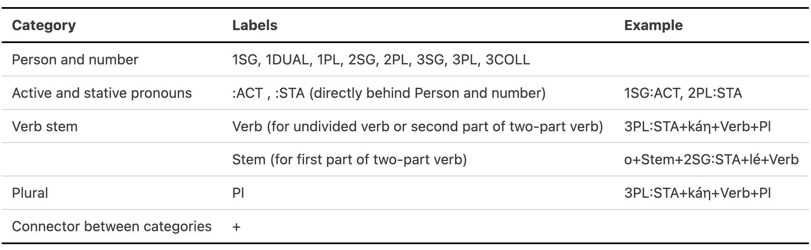

### verb.lexc 
This file produces a transducer network of verbs with placeholders PP1, PP2 or PP3 as well as M for personal pronouns, depending on the verb class.

#### Examples
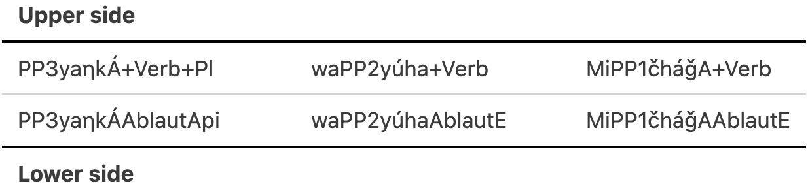

The upper side contains information as to where the persononal pronouns upper side will be inserted, as well as the verb marker and a plural marker if appropriate.
The lower side contains information as to where the personal pronouns lower side will be inserted as well as information on letters that undergo changes by verb.xfst (AblautA, AblautE, ^K, ^Y) and the plural ending pi, if appropriate.

In addition, the strings contain various diacritic flags, as shown for PP3yaηkÁ+Verb+Pl / PP3yaηkÁAblautApi.
#### Example with diacritic flags
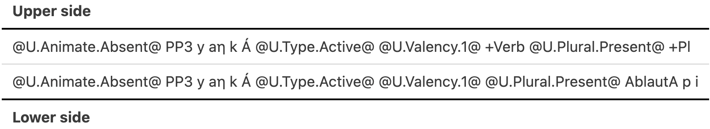

The diacritic flags provide control for using the appropriate sets of personal pronouns for 

- active vs. stative verb type (@U.Type.Active@, @U.Type.Stative@)
- animacy (@U.Animate.Present@, @U.Animate.Absent@)
- intransitive vs. transitive verbs (@U.Valency.1@, @U.Valency.2@)
- agreement with the plural marker absent or present (@U.Plural.Absent@, @U.Plural.Present@)

The lexica for the verb stems are divided by verb class for clarity. Division by animacy is needed for correct continuation classes.


### class1-personal-pronouns.lexc
This file produces a transducer network of all possible personal pronoun combinations for class 1 verbs including strings containing no pronouns, one pronoun or two pronouns.

#### Examples with two pronouns
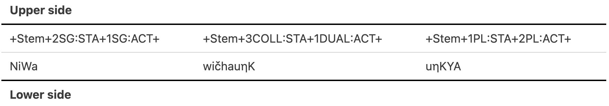

The upper side contains a stem marker and information about person, number and active or stative type of the personal pronouns. The lower side contains the personal pronouns as well as information on letters that undergo changes by verb.xfst (N, W, YA, K).

In addition, the strings contain various diacritic flags, as shown for +Stem+3SG:STA+2PL:ACT+ / ∅YA

#### Example with diacritic flags
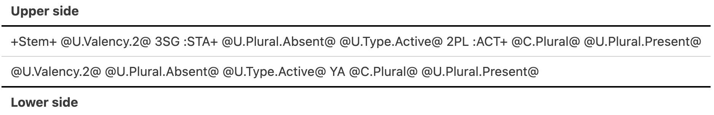

The diacritic flags provide control for using the appropriate sets of personal pronouns for the verb stems as described for the verb.lexc file.
In addition correct plural marking in the case of two personal pronouns with different numbers has to be controlled for (additional @C.Plural@, @R.Plural.Present@)

### class2-personal-pronouns.lexc
This file produces a transducer network of all possible personal pronoun combinations for class 2 verbs including strings containing no pronouns, one pronoun or two pronouns.
To account for a number of special personal pronoun combination rules, the continuation classes had to be split up for creation of combined personal pronouns. 

#### Examples
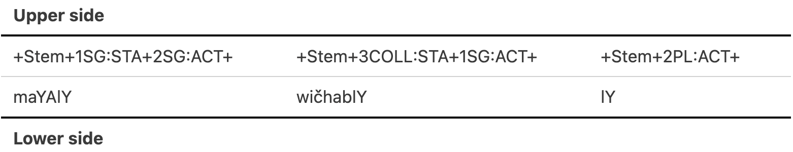

As described for class1-personal-pronouns.lexc, the upper side contains a stem marker and information about person, number and active or stative type of the personal pronouns. The lower side contains the personal pronouns as well as information on letters that undergo changes by verb.xfst (N, W, YA, K, Y).

Information about flag diacritics given for class1-personal-pronouns.lexc also apply for class2-personal-pronouns.lexc.

### class3-personal-pronouns.lexc
This file produces a transducer network of all possible personal pronoun combinations for class 2 verbs including strings containing no pronouns, one pronoun or two pronouns.
To account for a number of special personal pronoun combination rules, the continuation classes had to be split up for creation of combined personal pronouns. 

#### Examples
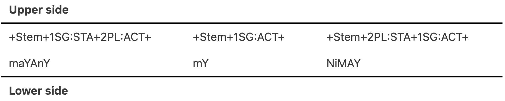

As described for class1-personal-pronouns.lexc, the upper side contains a stem marker and information about person, number and active or stative type of the personal pronouns. The lower side contains the personal pronouns as well as information on letters that undergo changes by verb.xfst (N, YA, MA, K, Y).

Information about flag diacritics given for class1-personal-pronouns.lexc also apply for class3-personal-pronouns.lexc.

### verb.xfst
This file combines the network produced from verb.lexc with the networks produced from class1-personal-pronouns.lexc, class2-personal-pronouns.lexc, and class3-personal-pronouns.lexc by inserting them into the placeholders PP1, PP2 and PP3, respectively. Before insertion, the personal pronoun networks are filtered for forbidden personal pronoun combinations. Furthermore, it accomplishes necessary reorderings of the personal pronouns, changes on morpheme boundaries, pronoun fusions, phonological changes induced by personal pronoun affixation and stress shift.
To do this, changes have to be applied to the lower as well as the upper side of the network to yield corresponding lexical and surface representations.

#### Example
Substituting a personal pronoun (combination) with the placeholder leads to intermediate upper and lower side representations as exemplified in the next table:

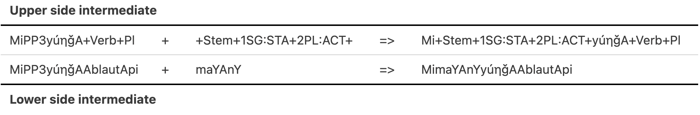

The xfst rules change these representations to yield the lexical side and surface representations:

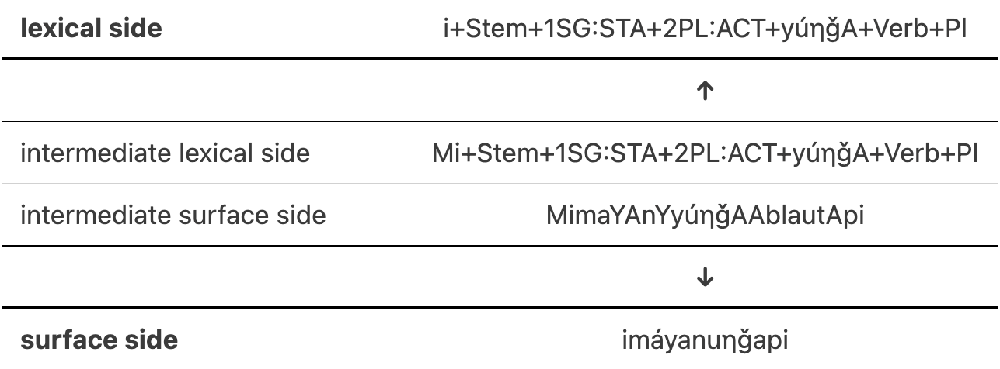

If a verb is of mixed type and integrates uη(k) this personal pronoun will first be inserted as infix and then moved to prefix position:

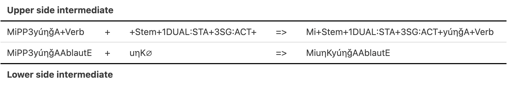

The xfst rules change these representations to yield the lexical side and surface representations:

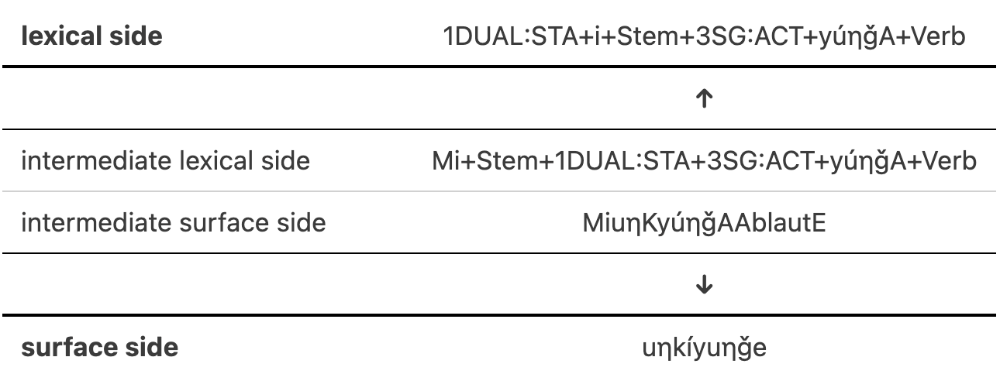

<br>

---
## GUIDANCE FOR EXTENSION
To add verb stems, make sure to
- determine the class the verb belongs to
- determine the type of affixing the personal pronouns (prefix, infix, mixed) and mark the verb stems accordingly (check the lexica in verb.lexc that are reached from *LEXICON Root* for guidance)
- determine whether the verb changes k to č after insertion of the personal ni or not. If not, change the k in the verb stem to ^K. (Alternatively, the xfst rule for changing k to č can be made optional, then both forms will be recognized or produced).
- determine whether syllables in the verb underly nasalization spread. If not, change y of the syllable that will not become nasalized to ^Y. (Note that nasalization spread is currently implemented very rudimentary: only syllables with nucleus a or á are implemented to change to aη or áη, respectively. It is implemented for syllables starting with y, w or h, according to Curtis, 2014, but only tested for syllables starting with y. For syllables starting with w or h, that do not become nasalized, marking will have to be established, such as ^W and ^H. Also, currently nasalization spread is only implemented for the first syllable that immediately follows uη.) (Also in this case, the xfst rules for changing a/á to aη/áη can be made optional, then both forms will be recognized or produced).
- determine whether the verb stem ends in an ablaut a or á. Mark this a or á as A or Á, respectively.
- when making further extensions, take care of special symbols already used

<br>

---
## REFERENCES
Verb form examples with their morphological analysis were taken from 

Buechel, Eugene (1939): A Grammar of Lakota : the language of the Teton Sioux Indians, Saint Francis Mission, South Dakota : Rosebud Educational Society.

Ingham, Bruce (2003): Lakota, Languages of the World/Materials 426: LINCOM GmbH

Lakota Language Consortium (2022), New Lakota Dictionary : 3rd. Edition,
Bloomington : Lakota Language Consortium.

<br>

---
## LICENSE
This project is licensed under the [Creative Commons Attribution-NonCommercial 4.0
International License (CC BY-NC 4.0)](LICENSE). You are free to use, share, and adapt
this work for non-commercial purposes, as long as you give appropriate credit ([see CITATION.cff](CITATION.cff)).

<br>

---
## FEEDBACK
I am happy to receive any feedback that helps to improve the analyzer.